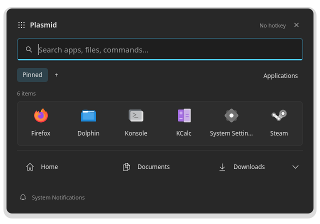
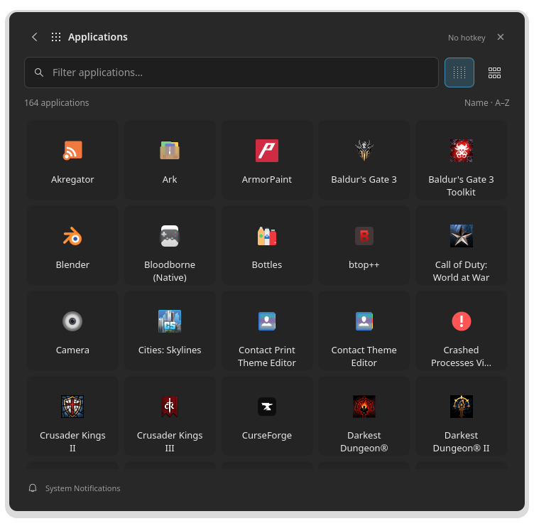

# Plasmid

[](https://ko-fi.com/U7U21UWJFZ)

A desktop dropdown for KDE Plasma: KRunner search, application browsing, recent downloads, and your own groups of apps, files, and folders. Press **Alt+Shift**, get what you need, carry on.

**Built for my personal use and my personal system theming.** Plasmid uses my own layout and styling, with colors and icons from the active KDE theme. Expect it to look different from standard Plasma Breeze. Consistency with Breeze is not a design goal.



## What it does

- **KRunner search:** find apps and files, run commands, and use your installed runners. Available results depend on your KRunner providers and file-indexing configuration.
- **Application browser:** browse installed applications in a roomy gallery or switch to a list. Search ranks application names ahead of incidental metadata matches.
- **Groups:** pin apps, files, and folders; create your own groups; rename them; expand their contents without leaving the main panel. The default **Pinned** group stays put.
- **Recent downloads:** filter recent items in your Downloads folder, open them with the system handler, or reveal them in Dolphin. A filesystem watcher keeps the list current without idle polling.
- **Lutris library:** include installed games from supported native and Flatpak Lutris libraries alongside ordinary applications.
- **File locations:** right-click supported results to **Show in File Explorer**. Application locations can include Steam game installations, executable locations, or desktop entries.
- **Local group suggestions:** suggest adding newly detected apps to a relevant group using existing group members and application metadata. No online categorization service. The bell disables suggestions and their background monitoring.
- **Animated resizing:** expand into the application browser, recent downloads, or a group's gallery, then return to the compact panel.

Home, Documents, and Downloads open in **Dolphin**. Files open through their system handlers. Plasmid closes before launching them.

## Screenshots

### Application browser



The main panel and application browser above use my dark theme and icon setup. These captures were taken without registering a shortcut, hence **No hotkey** in the header. Your colors, icons, and installed applications will vary.

### Preview another theme without changing your desktop

After building, use Python 3 to capture the main panel with an installed Plasma style:

```sh
python3 tools/preview-theme.py breeze-light
python3 tools/preview-theme.py breeze-dark
```

Images are saved in `build/theme-previews/`. The helper uses temporary configuration, data, cache, and state directories, an offscreen renderer, and a private D-Bus session. It does not open a desktop window, register shortcuts, send notifications, or change your Plasma settings.

Pass `--icons <installed-icon-theme>` to choose icons. For a style without its own colors, pass `--colors /path/to/scheme.colors`; otherwise it uses your current `kdeglobals` palette as the fallback. A style's own `colors` file takes precedence, matching Plasmid's normal behavior. This previews Plasmid's layout, colors, and icons, not an entire global theme or live compositor effects.

## Build and run

Plasmid currently targets **KDE Plasma 6 on Wayland**. It is a standalone application; KWin Overview integration is planned and is **not implemented** yet.

### Dependencies

- A C++20 compiler, **CMake 3.22+**, and Ninja or Make.
- **Qt 6.8+** development packages: Core, Gui, Widgets, Quick, Qml, DBus, Concurrent, and Sql.
- The Qt SQLite driver (**QSQLITE**) for Lutris library support.
- Plasma's **Milou**, **Kirigami**, and **LayerShellQt** QML modules (`org.kde.milou`, `org.kde.kirigami`, `org.kde.layershell`), plus LayerShellQt's Wayland shell integration.
- **KGlobalAccel**, **Dolphin**, **kstart**, **kioclient**, and **xdg-open**. The KDE command-line tools are commonly supplied by `kde-cli-tools`.
- For the default test-enabled build: **Qt Test** and **dbus-run-session**.

Package names vary by distribution.

```sh
cmake -S . -B build -G Ninja -DCMAKE_BUILD_TYPE=Release
cmake --build build
./build/plasmid-launcher
```

To build without the test dependencies, add `-DBUILD_TESTING=OFF` to the configure command.

The first launch opens the panel and keeps Plasmid running. Subsequent invocations toggle the existing instance. Running it does not set up autostart.

Upgrading from the earlier KShift development build? Stop that instance before starting Plasmid. On first launch, Plasmid copies your old groups, notification preferences, launcher settings, and download-arrival history to its new storage locations. Existing Plasmid settings are never overwritten, and the originals are preserved. Saved Lutris entries and the global-shortcut registration retain their identities so pins and existing shortcut assignments remain valid.

```sh
./build/plasmid-launcher --background    # Start hidden
./build/plasmid-launcher --no-shortcut   # Preview without registering Alt+Shift
./build/plasmid-launcher --quit          # Stop the running instance
```

In `--no-shortcut` mode, repeat the command to reopen a hidden panel. After rebuilding, quit the old instance before starting the new executable.

## Using Plasmid

| Action | Control |
| --- | --- |
| Show or hide the panel | **Alt+Shift** |
| Clear the current search | **Escape** when the search contains text |
| Close the panel | **Escape** when the search is empty, or **Alt+Shift** |
| Create a group | **+** after the last group tab |
| Rename or delete a custom group | Right-click its tab |
| Pin an item or add it to a group | Right-click the item |
| Show more items in a group | **Show all**, when there are enough items to expand |
| Open the application browser | **Applications** |
| Browse recent downloads | The arrow beside **Downloads** |
| Toggle Plasmid notifications | The bell beside **System Notifications** |

An item already in a group has a check mark beside that group. Successful additions show a short confirmation toast.

Clicking elsewhere inside the panel removes focus from the search field without clearing it. Switching focus to another window dismisses Plasmid. **Alt+Space** remains KRunner; **Alt+Tab** remains normal window switching. Plasmid's shortcut can be managed in **System Settings → Shortcuts → Plasmid**.

## Languages

English, **Polish**, German, French, and Spanish are included. Plasmid chooses a language from your system UI-language preferences at startup and falls back to English for unsupported languages. Restart it after changing your system language.

Your group names, filenames, and application names are preserved. Translation catalogs and contributor instructions live in [i18n/](i18n/README.md).

## FAQ

### Why doesn't Plasmid follow Breeze styling?

Because I don't use Breeze.

### Was this software made with AI assistance and if yes will it be rewritten with human hands?

Yes, AI was used. No, it will not be rewritten. It's code, not a visual novel.

### Is this a replacement for the Plasma launcher or KWin Overview?

It's a standalone dropdown built for my own workflow. Overview integration is a future step; the current version does not modify Overview.

### Does “System Notifications” mute the rest of my desktop?

No. The bell controls Plasmid's own app-group suggestions. Turning it off also stops their categorization and background app monitoring. Choosing **Never** on a suggestion switches that bell off globally.

### Does Lutris have to be installed? What about forks or unusual library locations?

No. Missing Lutris libraries are skipped. Plasmid supports native and Flatpak Lutris SQLite libraries, including a custom `pga_path` set in the matching `lutris.conf`. An unreadable or incompatible database does not prevent ordinary application browsing. Forks using another storage format or a remote service need a separate adapter.

### Will it look and behave exactly the same on my system?

Probably not. This is a personal project developed around my own Plasma setup and theming. Different themes, icons, runners, and desktop versions can produce different results. If you report a problem, include your Plasma and Qt versions, theme, and steps to reproduce it.

## Development

Built with **C++20, Qt Quick/QML, and KDE components**. KRunner providers run in Plasmid's application process.

```sh
ctest --test-dir build --output-on-failure
```

The tests cover search actions, application and Lutris catalogs, Downloads watching, groups and suggestions, translations, settings migration, instance handling, and offscreen UI interactions. Live Wayland behavior still needs desktop testing.

## License

Copyright © 2026 Vem0n and contributors.

Plasmid is free software, licensed under the **GNU General Public License, version 3 or (at your option) any later version** (`GPL-3.0-or-later`). See [LICENSE](LICENSE) for the full terms.

Distributed without warranty. Qt, KDE components, themes, and icons retain their respective licenses.
